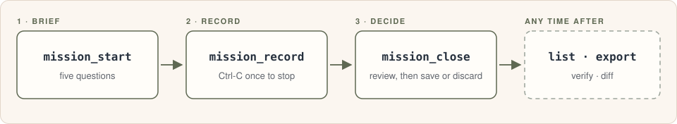
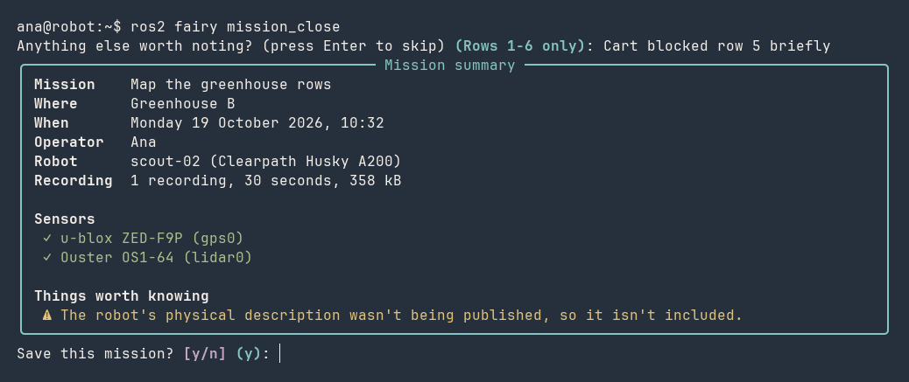

<p align="center">
  
</p>

<h1 align="center">ROS F.A.I.R.y</h1>

<p align="center">
  <strong>Field-mission data for ROS 2 that stays usable years later.</strong><br>
  Five questions before a run; everything else about the robot is captured on its own.<br>
  Every mission is saved as a checksummed <a href="https://www.researchobject.org/ro-crate/">RO-Crate</a> archive.
</p>

<p align="center">
  <a href="https://mlisi1.github.io/ros_fairy/"><strong>Documentation</strong></a> ·
  <a href="https://mlisi1.github.io/ros_fairy/getting-started/">Getting started</a> ·
  <a href="https://mlisi1.github.io/ros_fairy/operator-guide/">Operator guide</a> ·
  <a href="https://mlisi1.github.io/ros_fairy/commands/">Commands</a>
</p>

---

A rosbag records what the sensors said. It doesn't record which robot it was,
how it was configured, which software and parameters were running, what the
mission was for, or whether the recording is any good. Months later, that is
what decides whether the data can be found, trusted and reused.

ROS F.A.I.R.y (the `fairy` package) makes field data
[FAIR](https://mlisi1.github.io/ros_fairy/references/#fair) (Findable,
Accessible, Interoperable, Reusable) without extra work in the field. It is a
`ros2 fairy` command for the operator and a background service that does the
rest.

## How a mission goes

<p align="center">
  <picture>
    <source media="(prefers-color-scheme: dark)" srcset="docs/assets/diagrams/mission-flow-dark.svg">
    
  </picture>
</p>

```bash
ros2 fairy mission_start      # five plain-language questions: who, what for, where
ros2 fairy mission_record     # ros2 bag record, after checking disk, clock and briefing
ros2 fairy mission_close      # review the mission and its data quality, then save
```

While the robot records, the background service captures the context, so
nothing has to be remembered or typed. It notices plain `ros2 bag record` runs
and recorders inside Docker containers too, not only `mission_record`. At the
end, `mission_close` shows a summary in plain language:

<p align="center">
  
</p>

## What it captures

- **The mission:** the operator's five answers (who, the goal, the place, the
  environment, notes).
- **The robot:** its identity and owner, the sensors declared and the ones
  seen publishing, the URDF and `/tf_static`.
- **The software:** the ROS graph with every node's parameters, ROS and Python
  packages, Docker containers and what they run, and the exact ROS F.A.I.R.y
  build that captured and saved it.
- **The machine:** hardware devices, how each USB device and port is managed,
  the udev rules that apply, system information.
- **The recordings:** their health in plain words (gaps, low rates, clock
  jumps, cut-off files, sensors that never published), and a quality grade
  for the mission: ok, degraded or poor.

Details: [What is captured](https://mlisi1.github.io/ros_fairy/what-is-captured/).

## After the mission

Each mission is an [RO-Crate](https://mlisi1.github.io/ros_fairy/archive-format/)
folder: the recordings, a machine-readable `mission_record.json`, a
human-readable `README.md`, and a checksum for every file. Saving is crash-safe:
an interrupted save is finished or rolled back, never left half-done.

```bash
ros2 fairy list --search "north pier"   # find missions by words, operator, place, date, quality
ros2 fairy diff 2 1                     # what changed between two missions
ros2 fairy export 1 --compress          # one file to share, with its sha256
ros2 fairy verify mission.zip           # the recipient checks it, without unpacking
```

## Install

ROS 2 Jazzy on Ubuntu 24.04. On the robot's computer:

```bash
git clone https://github.com/mlisi1/ros_fairy.git
cd ros_fairy
./install.sh             # installs the package; offers the optional tools it uses
ros2 fairy setup         # the robot's identity, the data folder, the background service
ros2 fairy doctor        # checks that the robot is ready to capture
```

`setup` asks for your password only when it writes `/etc/ros-fairy` and
installs the service. It also builds in a colcon workspace; see
[Getting started](https://mlisi1.github.io/ros_fairy/getting-started/) for that,
for robots whose ROS runs in Docker, and for `./uninstall.sh` (which keeps your
saved missions).

**Status:** 0.1.0, the first release. It is in use on a field robot, but the
command line and the record format may still change before 1.0.

## Commands

| Command | What it does |
| --- | --- |
| `setup` | Set the robot up once; later, change one part with its flags |
| `doctor` | Check that the robot is ready, and say how to fix what isn't |
| `mission_start` | Describe the mission: five questions, or options for scripts and launch files |
| `mission_record` | Record (wraps `ros2 bag record` and takes its options) |
| `mission_status` | What is going on right now |
| `mission_close` | Review the mission, then save or discard it |
| `mission_abort` | Abandon a mission that couldn't go ahead |
| `drop`, `adopt` | Take one recording out of the open mission, or bring in one made elsewhere |
| `list` | The missions saved on this robot, with filters and word search |
| `diff` | Compare two missions |
| `verify` | Check that a saved mission, or an exported bundle, is complete and unmodified |
| `export` | Package missions as `.zip`, `.tar`, `.tar.gz` or `.tar.zst` |
| `mission_edit` | Fix a saved mission's briefing, keeping the change in its history |
| `mission_delete` | Delete saved missions, after typing a confirmation |
| `repair` | Make recordings with a bad clock playable |
| `reindex` | Rebuild the mission list from the archive |
| `add_operator` | Let more accounts record missions |
| `move_data` | Move recordings and saved missions to another disk |

Every option: [Command reference](https://mlisi1.github.io/ros_fairy/commands/).

## Contributing

```bash
./install.sh --dev            # also installs pytest, rocrate, ruff and mypy
pytest                        # no ROS needed
ruff check . && mypy fairy
```

See [CONTRIBUTING.md](CONTRIBUTING.md), and the
[Development](https://mlisi1.github.io/ros_fairy/development/) page for the
code's layout, the tests and the sandbox robot (a throwaway robot in Docker).

## Citing

If you use ROS F.A.I.R.y in your research, please cite it: GitHub's "Cite
this repository" button (from [CITATION.cff](CITATION.cff)) gives the
reference in APA and BibTeX.

## License

Apache-2.0: see [LICENSE](LICENSE).
