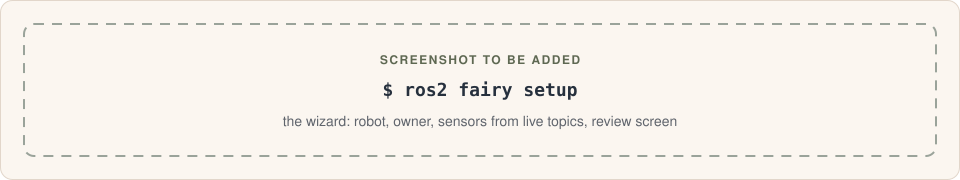
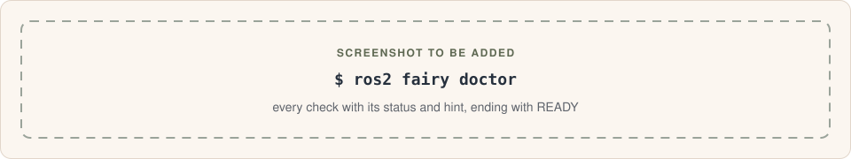
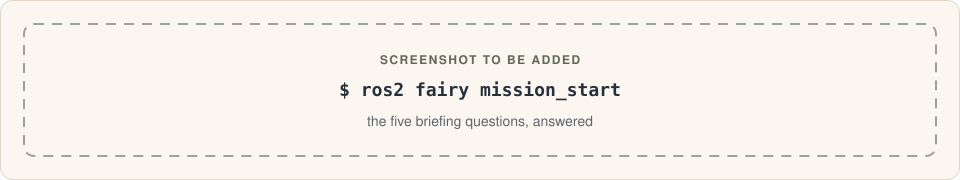
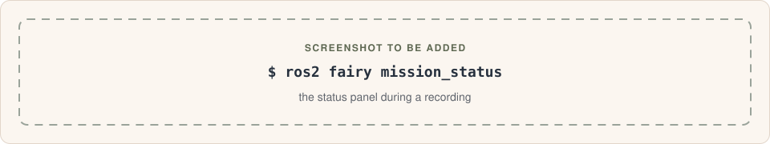
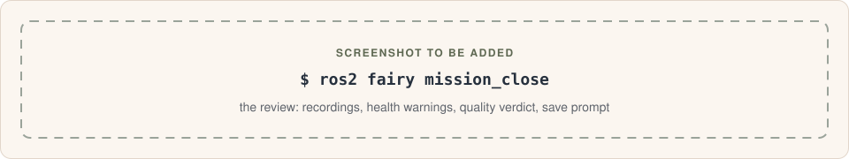
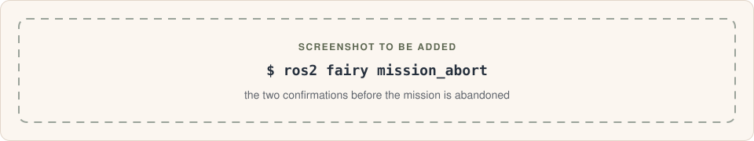
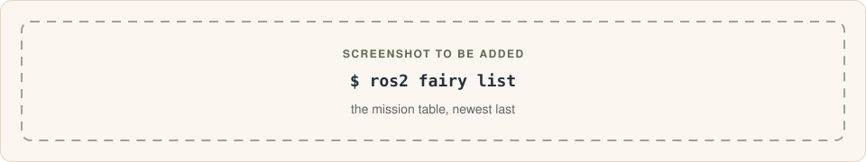
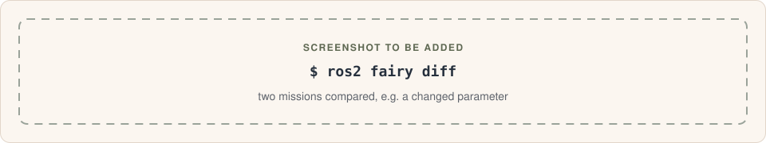
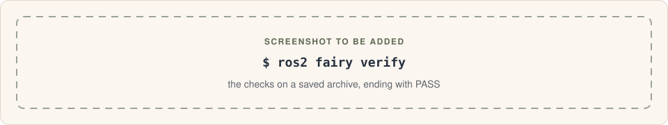

# Command reference

Every verb is `ros2 fairy <verb>`. `ros2 fairy` on its own lists them.

## Common behaviour

- **`--debug`** (every verb): verbose logging to stderr, and full tracebacks
  instead of the friendly error message.
- **`--json`** (where listed): machine-readable output on stdout. Errors are
  `{"status": "error", "error": "<message>"}`.
- **Mission identifiers.** Verbs that take a mission accept, in order of
  precedence: an archive folder path, a number (`1` = newest, `2` = the one
  before), or a mission ID such as `m-20261002-082109-1a2b`.
- **Exit codes.**

  | Code | Meaning |
  | --- | --- |
  | `0` | Success, including "you declined, nothing changed". |
  | `1` | The command refused or failed. |
  | `2` | It needed to ask a question but there was no terminal (use `--yes` where available). |
  | `130` | Cancelled with Ctrl-C. Nothing was changed. |

| Verb | Summary |
| --- | --- |
| [`setup`](#setup) | One-time robot setup: identity file, directories, watchdog service |
| [`doctor`](#doctor) | Check that this robot is ready to capture a mission |
| [`mission_start`](#mission_start) | Answer five quick questions to describe the mission |
| [`mission_record`](#mission_record) | Record mission data (wraps `ros2 bag record`) |
| [`mission_status`](#mission_status) | Show what the recording assistant is doing right now |
| [`mission_close`](#mission_close) | Review the finished mission and save or discard it |
| [`mission_abort`](#mission_abort) | Abandon the open mission without saving |
| [`mission_delete`](#mission_delete) | Permanently delete saved missions |
| [`list`](#list) | List the missions saved on this robot |
| [`diff`](#diff) | Compare two missions and show what changed |
| [`verify`](#verify) | Check that a saved archive is complete and unmodified |
| [`export`](#export) | Package missions into portable, checksummed files |
| [`repair`](#repair) | Make unplayable (bad-clock) recordings playable |
| [`adopt`](#adopt) | Attach a bag recorded outside `mission_record` |
| [`reindex`](#reindex) | Rebuild the mission list from the archives on disk |

## setup

```
ros2 fairy setup [--ros-setup PATH] [--debug]
```

<!-- TODO: replace with a real screenshot of `ros2 fairy setup` -->


The interactive robot setup described in
[Set up the robot](getting-started.md#2-set-up-the-robot). Run it as your
normal user: only the final step uses `sudo`, and the answers are passed to it
on stdin.

| Option | |
| --- | --- |
| `--ros-setup PATH` | Only when running setup directly as root (`sudo ros-fairy-setup`): the ROS 2 `setup.bash` to source. Auto-detected when there is exactly one `/opt/ros/*/setup.bash`. |

It refuses (exit 1) if ROS isn't sourced, no ROS nodes are visible, or the
service (which runs as root) couldn't load ros_fairy, e.g. when it is only
installed in a home directory. It also fails if `sudo` isn't available, or the
service doesn't come up within 10 s (then check
`journalctl -u ros-fairy-watchdog`). Declining the review writes nothing and
exits 0.

`ros-fairy-setup` is the same command as a standalone script.

## doctor

```
ros2 fairy doctor [--json] [--debug]
```

<!-- TODO: replace with a real screenshot of `ros2 fairy doctor` -->


Read-only checks, each reported as ok, warning, failure or skipped:

| Check | Fails / warns when |
| --- | --- |
| Robot identity | `robot_identity.yaml` is missing or invalid |
| Recording assistant | the watchdog isn't running, or has been recording with no heartbeat for 5 minutes |
| Service interpreter | the installed service's interpreter can't load ros_fairy (only installed in a home directory) |
| Watchdog code | the running watchdog's code differs from the installed code (restart it) |
| ROS graph | `ros2` isn't on `PATH`, ROS isn't reachable, or no nodes are running |
| ROS environment | `ROS_DISTRO` isn't set in this shell |
| Service environment | `watchdog.env` is missing, or its domain/RMW differs from this shell |
| Last harvest | the last ROS capture failed |
| Clock | the system clock isn't NTP-synchronised |
| MCAP support | the `mcap` Python package is missing |
| Disk space | less than 1 GiB free for the spool |
| Docker | (skipped when Docker isn't used) |
| Saved missions | an interrupted save is waiting to be finished |

Result: **READY**, **READY (with warnings)** or **NOT READY**. Exit code 1 only on
NOT READY. `--json` prints `{"result": ..., "checks": [{status, title, detail, hint}]}`.

## mission_start

```
ros2 fairy mission_start [--debug]
```

<!-- TODO: replace with a real screenshot of `ros2 fairy mission_start` -->


Asks the [five briefing questions](operator-guide.md#1-start-the-mission-mission_start)
and saves them to the spool. It also records the shell's DDS settings for the
watchdog (`session.env`).

It refuses (exit 1) while a recording is running, or while the spool holds
recordings that haven't been saved or discarded. It asks before replacing an
unfinished mission that has no recordings. There is no `--yes`.

## mission_record

```
ros2 fairy mission_record [--yes] [--debug]
```

Runs:

```
ros2 bag record <topics…|--all> [--storage <format>] --output <spool>/bags/<mission_id>_<YYYYmmdd-HHMMSS>
```

Topics and storage come from `recording:` in
[`robot_identity.yaml`](configuration.md#robot_identityyaml). Without a mission
open, the folder prefix is `unbriefed`. No other options are passed through.

| Option | |
| --- | --- |
| `--yes`, `-y` | Record without asking about low disk space, a missing briefing or an unsynchronised clock. |

Before recording it checks that `ros2` exists (exit 1 if not), free disk space
(at least 1 GiB, otherwise it asks), that a briefing exists, that the watchdog
is running (warning only) and clock sync (asks).

Ctrl-C forwards one SIGINT so rosbag2 finishes the file cleanly. Two further
presses force it to stop. SIGTERM and SIGHUP are handled the same way. Exit 1
if the recorder exits with an error; the data captured so far is kept.

## mission_status

```
ros2 fairy mission_status [--json] [--debug]
```

<!-- TODO: replace with a real screenshot of `ros2 fairy mission_status` -->


Shows:

| Row | Content |
| --- | --- |
| Assistant | not running · not responding · recording (since when) · wrapping up · watching |
| Briefing | operator and goal, or "not started yet" |
| Recording | the active bag and its size so far |
| Recordings waiting | recordings to close, with total size |
| Context captured | per harvest module: ✓ captured, ⚠ partial, – not used on this robot, ✗ will keep trying |

`--json` keys: `assistant`, `watchdog_state`, `mission_context`, `spool_bags`,
`recordings`, `recording_now`. Always exits 0.

## mission_close

```
ros2 fairy mission_close [--note TEXT] [--yes] [--debug]
```

<!-- TODO: replace with a real screenshot of `ros2 fairy mission_close` -->


| Option | |
| --- | --- |
| `--note TEXT` | Post-mission notes; skips the notes question. |
| `--yes`, `-y` | Save without asking. Also finishes an interrupted save. The briefing must already exist. |

In order:

1. Offers to finish any save that was interrupted.
2. Refuses (exit 1) while a recording is in progress. Waits up to 245 s for
   the watchdog to finish a capture.
3. Picks up spool recordings the watchdog hadn't processed.
4. Asks missing briefing answers and notes.
5. Builds the mission record, grades its quality, checks for duplicates, and
   shows the review.
6. **Save** (default yes, or no when the quality is poor). If you don't save, it
   asks whether to **discard** (delete the spool recordings and capture) or
   **keep** (change nothing).

Exit 1 when there is nothing recorded, the briefing is missing and there is no
terminal to ask in, or the save fails. When a save fails before completing,
your data is left exactly as it was.

## mission_abort

```
ros2 fairy mission_abort [--yes] [--debug]
```

<!-- TODO: replace with a real screenshot of `ros2 fairy mission_abort` -->


Abandons the open mission. It asks to confirm, and again before deleting
spool recordings. Recordings made outside ros_fairy are never deleted.
`--yes` skips both questions. It refuses while a recording is in progress.

## mission_delete

```
ros2 fairy mission_delete (MISSION_ID | --today | --all) [--debug]
```

| Form | |
| --- | --- |
| `MISSION_ID` | One mission, by exact ID only (not a number or a path). |
| `--today` | Every mission recorded today. Uses `sudo`. |
| `--all` | Every saved mission. Uses `sudo`. |

Needs an interactive terminal. It shows what will and won't be deleted,
asks to confirm, then prompts you to type a confirmation phrase exactly. It only ever deletes folders directly inside the archive directory.
A mission saved by another account can be deleted with `sudo` after asking.
There is no `--yes`.

## list

```
ros2 fairy list [--operator NAME] [--location PLACE] [--since YYYY-MM-DD]
                [--until YYYY-MM-DD] [--quality {ok,degraded,poor}]
                [--search WORDS] [--limit N | --all] [--path] [--json]
                [--debug]
```

<!-- TODO: replace with a real screenshot of `ros2 fairy list` -->


| Option | |
| --- | --- |
| `--operator`, `--location` | Case-insensitive substring match. |
| `--since`, `--until` | Local dates, both inclusive. |
| `--quality` | Only missions with this verdict. |
| `--search WORDS` | Only missions whose goal or notes contain every word, in any order. Case and accents are ignored (`citta` finds "Città"); quote a phrase to keep it together: `--search '"north pier" sonar'`. |
| `--limit N` | Show the latest N (default 20; at least 1). |
| `--all` | Show every mission. |
| `--path` | Add the archive folder column. |

Columns: date, mission ID, goal, location, operator, duration, size, warnings
and data quality. The newest mission is last. Filters combine: every one must
match. `--json` prints `{"missions": [...], "total": N, "shown": M}`; each
mission carries the index columns, `notes` included.

## diff

```
ros2 fairy diff [OLDER NEWER] [--json] [--debug]
```

<!-- TODO: replace with a real screenshot of `ros2 fairy diff` -->


With no arguments, compares the two most recent missions (`2` and `1`). Give
both or neither.

It only shows sections that differ: mission context, software (packages, Python,
containers), sensors, ROS graph, parameters, robot description (URDF),
`/tf_static`, USB and udev, and recordings. tf2's randomly-named internal nodes
are ignored. If a mission was saved by a newer ros_fairy, it says what it
couldn't compare.

## verify

```
ros2 fairy verify [MISSION] [--json] [--debug]
```

<!-- TODO: replace with a real screenshot of `ros2 fairy verify` -->


Defaults to the newest mission. Read-only. Checks that:

- `mission_record.json` loads and validates;
- `ro-crate-metadata.json` is valid JSON. It is fully loaded as JSON-LD when the
  `rocrate` package is installed; otherwise a warning suggests installing it;
- `README.md` and `harvest/harvest.json` are present;
- every bag file matches the sha256 recorded at save time (older archives
  without checksums get a structural check against `metadata.yaml`);
- every calibration file matches its sha256;
- every other file matches `checksums.sha256`, and none were added;
- every file the RO-Crate lists exists;
- the mission is in the index, at this path.

Result: **PASS**, **PASS (with notes)** or **FAIL**. Exit 1 on FAIL.

## export

```
ros2 fairy export [MISSION | --all | --today] [--exclude ID]... [-o PATH]
                  [--format {zip,tar}] [--force] [--yes] [--json] [--debug]
```

| Option | |
| --- | --- |
| `MISSION` | Defaults to the newest. |
| `--all` | Every mission not yet exported successfully. |
| `--today` | Every mission recorded today. |
| `--exclude`, `-e ID` | Skip this mission (repeatable; with `--all`/`--today`). |
| `--output`, `-o` | A file name (one mission) or a directory. Default: the current directory. |
| `--format` | `zip` (default) or `tar`. |
| `--force` | Overwrite existing files. |
| `--yes`, `-y` | Don't ask before batch exports. Implied by `--json`. |

Each bundle holds the mission folder uncompressed, under one top-level folder, next to a `sha256sum`-compatible
`<bundle>.sha256`. The bundle is written to a `.part` file and renamed when
complete. Missions that fail `verify` are exported with a warning. The archive
is never modified. Exit 1 if any export failed.

## repair

```
ros2 fairy repair [MISSION | BAG_DIR] [-o DIR] [--all] [--duration SECONDS]
                  [--force] [--json] [--debug]
```

| Option | |
| --- | --- |
| `MISSION` / `BAG_DIR` | A mission (default: newest) or a single bag folder. |
| `--output`, `-o` | Where to write. Default: `./<name>_repaired`. Must be empty unless `--force`. |
| `--all` | Re-stamp every recording, not only those with a broken clock. |
| `--duration` | Playback length in seconds for each repaired recording. |

Writes new bags with evenly spaced synthetic timestamps and a regenerated
`metadata.yaml`, so they play without `ros2 bag reindex`. Message order, types
and bytes are unchanged. Originals are never modified. MCAP recordings come out
as one `.mcap` file; sqlite3 recordings keep their `.db3` files, splits
included. Bags in another storage format, or compressed as whole files
(`.mcap.zstd`, `.db3.zstd`), are reported as unsupported.

`tools/restamp_bag.py <in> <out> [--duration S]` does the same for one bag
without needing the CLI.

## adopt

```
ros2 fairy adopt BAGDIR [--json] [--debug]
```

Attaches a rosbag2 folder (`metadata.yaml` plus a `.mcap`/`.db3` file) to the
current mission, where it is. If the watchdog hasn't captured anything yet, it
runs a capture now. The bag is copied into the archive at `mission_close`.

Refuses while the watchdog is busy recording. Adopting the same bag twice is a
no-op.

## reindex

```
ros2 fairy reindex [--json] [--debug]
```

Rebuilds `index.db` from every `archive/*/mission_record.json`. Unreadable
folders are reported and skipped. If the same mission was saved twice, the most
recent save is listed and you are told about the other. Export history is
kept.

`--json` prints `{"missions": N, "archive_dir": ..., "skipped": [...], "duplicates": {...}}`.
